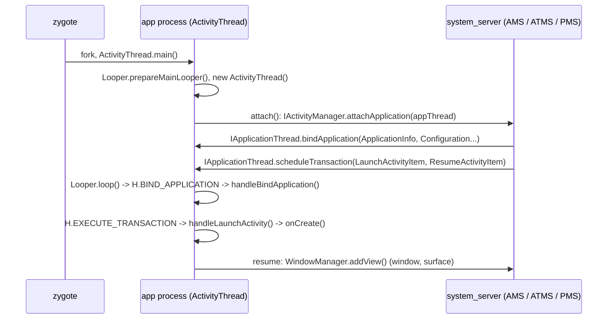

# Running an Android application: Android vs Sandvik

Sandvik runs an APK on the unmodified Android 12 framework (`javalib.jar`, `core-oj`, `core-libart`...). On a device, starting an app involves several processes (zygote, `system_server`) talking over binder, and native libraries (libandroidfw, hwui, minikin, ICU...). Sandvik runs a single process with no binder driver: this document
explains, for each step, what Android does and what Sandvik does instead, and where the code is.

```bash
LD_LIBRARY_PATH=wbuild ./wbuild/sandvik --android-version=12.0.0 --apk tests/java/helloapk/hello.apk
# Hello World!   <- printed by MainActivity.onCreate()
```

## 1. Application startup on Android



- `bindApplication()` → `handleBindApplication()`: process setup (VMRuntime, locale, time zone, fonts), `LoadedApk`
  (the APK), the application `ContextImpl` and its `Resources` (AssetManager over `framework-res.apk` + the APK),
  the application `ClassLoader` (`PathClassLoader` → `DexFile`), `Application.onCreate()`.
- `LaunchActivityItem` → `performLaunchActivity()`: `Instrumentation.newActivity()` (loads and instantiates the
  activity class), `Activity.attach()` (creates the `PhoneWindow`), `Activity.onCreate()`.
- The app constantly calls `system_server` through binder: `PackageManager` (`package`), `ActivityManager`
  (`activity`), `ActivityClientController` (activity ↔ task manager), the settings content provider, etc.

## 2. What Sandvik does

| Step / component             | Android                                                                     | Sandvik                                                                                                                                                                                                                                                                                      | Code                                                                                          |
| ---------------------------- | --------------------------------------------------------------------------- | -------------------------------------------------------------------------------------------------------------------------------------------------------------------------------------------------------------------------------------------------------------------------------------------- | --------------------------------------------------------------------------------------------- |
| Process start                | zygote forks, `ActivityThread.main()`                                       | `--apk`: `Vm::run()` runs `android.app.SandvikLauncher <apk> <package> <activity>` (package and activity come from the manifest)                                                                                                                                                             | `src/vm.cpp`, `android/12.0.0/java/src/android/app/SandvikLauncher.java`                      |
| `ActivityThread.attach()`    | calls AMS `attachApplication()`                                             | replayed by the launcher without the AMS call                                                                                                                                                                                                                                                | `SandvikLauncher.attach()`                                                                    |
| `system_server` (AMS)        | sends `bindApplication()` and the launch transaction                        | the launcher calls them on the local `ApplicationThread` (a binder `Stub`, so no IPC); only `LaunchActivityItem`, no resume yet                                                                                                                                                              | `SandvikLauncher.main()`                                                                      |
| servicemanager / binder      | binder driver, `ServiceManager.getService(name)`                            | `SandvikServiceManager`: in-process registry. A service not registered is absent (`null`), the framework then takes its "service not available" path                                                                                                                                         | `android/os/SandvikServiceManager.java`                                                       |
| System services              | `system_server`                                                             | in-process `Stub` implementations: `package` (`SandvikPackageManager`), `activity` (`SandvikActivityManager`, publishes the settings provider), `SandvikActivityClientController` (given in `LaunchActivityItem`), `SandvikSettingsProvider` (in memory, undefined setting → caller default) | `android/12.0.0/java/src/`                                                                    |
| Mainline module initializers | `ConnectivityFrameworkInitializer`... come with the APEX modules            | `javalib.jar` only has stubs throwing `Stub!`: Sandvik replacements register nothing (`getSystemService()` returns `null` for these services)                                                                                                                                                | `android/12.0.0/java/src/android/{net,media,os,...}`                                          |
| Class loading                | `PathClassLoader` → `DexFile` (ART)                                         | one class namespace: every dex is in the VM `ClassLoader`; `DexFile.openDexFileNative` loads the file there if needed, `defineClassNative` looks the class up. App classes report the boot class loader                                                                                      | `natives/dalvik/system/DexFile.cpp`                                                           |
| Resources                    | libandroidfw (`ApkAssets`, `AssetManager2`, `Theme`, `AttributeResolution`) | `src/resources`: own C++ parser of `resources.arsc` (see §3)                                                                                                                                                                                                                                 | `src/resources/`, `natives/android/content/res/`                                              |
| Fonts                        | minikin, `/system/etc/fonts.xml`                                            | `fonts.xml` with Roboto in the fake `/system`; native typefaces/fonts only keep what Java reads back (style, weight, path, axes)                                                                                                                                                             | `natives/android/graphics/{Typeface,fonts/}`                                                  |
| `java.util.regex`            | ICU4C `uregex`                                                              | ICU4C `uregex` (system libicu)                                                                                                                                                                                                                                                               | `natives/com/android/icu/util/regex/`                                                         |
| Rendering (hwui), GPU        | native renderer                                                             | no-op stubs for the process wide settings                                                                                                                                                                                                                                                    | `natives/android/graphics/HardwareRenderer.cpp`, `natives/android/os/GraphicsEnvironment.cpp` |
| Filesystem                   | real `/system`, `/data`                                                     | `VFS::resolve()`: `/data/...` → host cache `/tmp/sandvik-<uid>/data` (writable, per user); other missing absolute paths → `android/12.0.0/fs`                                                                                                                                                | `src/vfs.cpp`                                                                                 |
| App data dirs                | created by installd                                                         | created by the launcher                                                                                                                                                                                                                                                                      | `SandvikLauncher.main()`                                                                      |

### Generated service bases

AIDL interfaces have hundreds of methods (`IPackageManager`: 204, `IActivityManager`: 222). At build time,
`android/12.0.0/java/gen_service_bases.py` reads the interface from `javalib.jar` and generates an abstract base
class (`PackageManagerServiceBase`...) whose methods return nothing (`null`, `0`, `false`). The Sandvik service only
overrides what it implements. To add a service:

1. add `'<aidl interface>': '<Base class>'` to `SERVICES` in `gen_service_bases.py`;
2. write the service extending the base class in `android/12.0.0/java/src/<package>/`;
3. register it in `SandvikLauncher` (`serviceManager.addService(name, service, false, 0)`);
4. rebuild the jar: `android/12.0.0/java/build.sh` (outputs `android/12.0.0/bin/sandvik-framework.dex.jar`, listed
   before `javalib.dex.jar` in `order.txt` so its classes take precedence over the framework ones).

### `ActivityThread.main` without the launcher

`--main android.app.ActivityThread` still runs `ActivityThread.main()`: there the binder stubs
(`BinderInternal.getContextObject`, `Parcel.nativeReadStrongBinder` returning a `Binder`) make every service a
dead binder proxy, so `attach()` completes and the thread waits in `Looper.loop()`. The launcher does not rely on
it: it installs `SandvikServiceManager` first.

## 3. Resources (`src/resources`)

Same model as libandroidfw, simplified:

| libandroidfw                  | Sandvik                            | Role                                                                                                          |
| ----------------------------- | ---------------------------------- | ------------------------------------------------------------------------------------------------------------- |
| `ResourceTypes.h`             | `resource_types.hpp`               | binary layout of `resources.arsc` and binary XML; `ByteView` bounds checks every read                         |
| `ResStringPool`               | `StringPool`                       | UTF-8/UTF-16 string pools and style spans, decoded on demand, no copy                                         |
| `ResTable_config`             | `ResConfig`                        | configuration qualifiers, `match()` and `isBetterThan()` (best variant selection, density scaling rules)      |
| `LoadedArsc`, `LoadedPackage` | `ResourceTable`, `ResourcePackage` | packages, types, configuration variants, entries (simple values and bags)                                     |
| `ApkAssets`                   | `ApkAssets`                        | APK (zip) or bare arsc                                                                                        |
| `AssetManager2`               | `AssetManager`                     | lookup by id for the current configuration, reference resolution, bags merged with their parents, names ↔ ids |
| `Theme`                       | `Theme`                            | applied styles, `?attr` resolution                                                                            |
| `AttributeResolution`         | `attribute_resolution`             | `obtainStyledAttributes` (XML attribute → XML style → default style → theme)                                  |

JNI glue: `natives/android/content/res/{ApkAssets,AssetManager,StringBlock}.cpp`. Native objects are handed to Java
as ids of a `HandleRegistry` (not raw pointers). A Java cookie is the index of the ApkAssets + 1, -1 when the value
does not come from an ApkAssets.

`TypedArray` passes `VMRuntime.addressOf(int[])` to the natives. Sandvik arrays are not a contiguous primitive
buffer, so `addressOf()` returns the array object itself and the natives write it through JNI.

**`framework-res.apk` must come from the same AOSP build as `javalib.jar`**: the internal resource ids
(`com.android.internal.R`) differ between builds. `./waf configure` installs
`android/12.0.0/fs/system/framework/framework-res.apk` from `android/12.0.0/bin/framework-res.apk` when present
(AOSP `out/target/product/<target>/system/framework/framework-res.apk`), otherwise from the SDK `android.jar`
(API 31), whose public ids match but about half of the internal ids do not (e.g. zygote resource preloading reads
`R.array.preloaded_drawables` and gets another array).

Not implemented yet: binary XML (`XmlBlock`, so layouts and XML drawables), assets (`AssetManager.open`),
overlays and shared library packages (dynamic reference tables).

## 4. VM behaviours the framework relies on

These were fixed or added to run the startup path; they apply to any program:

- **Strings are UTF-16** (`StringObject` keeps UTF-16 and a UTF-8 copy for the native side): `length()`, `charAt()`,
  substrings... are in UTF-16 code units. Dex strings (Modified UTF-8) are decoded accordingly.
- **Java called from native code runs on the calling thread** (`NestedCall`, `src/jthread.hpp`): JNI `Call*Method`
  / `NewObject`, `Method.invoke`, `Constructor.newInstance`. `Thread.currentThread()` and the thread locals
  (`Looper`, Binder calling identity, StrictMode) are the caller ones, as in ART.
- **Static initial values** (`class_def.static_values`) are applied when the class is initialized: the compiler
  drops the `<clinit>` assignment of constant static fields.
- **Annotations instances** (`Class/Field.getAnnotation`): ART uses `java.lang.reflect.Proxy`; Sandvik synthesizes one
  implementation class per annotation type (`src/annotation_factory.cpp`), element values from the dex or from the
  annotation defaults.
- **`libcore.io.Linux` natives throw `android.system.ErrnoException`** (with `errno`), as callers catch it to take
  their "file missing" paths.
- **JNI symbol lookup** also tries the standard JNI mangled name (`_1`, `_00024` for inner classes): existing natives
  keep their unescaped names.
- `System.arraycopy` handles overlapping ranges in the same array, `Field.get/set` initialize the class and box
  primitives, the main `Thread` has its `lock`/`blockerLock` objects.

## 5. Debugging the startup

```bash
LD_LIBRARY_PATH=wbuild ./wbuild/sandvik -c --app-log=DEBUG --logfile=/tmp/apk.log --no-console \
  --android-version=12.0.0 --apk tests/java/helloapk/hello.apk
grep -a '^\[!\]\|^\[app\]' /tmp/apk.log | tail            # first error and framework logs
grep -a '^\[c\]' /tmp/apk.log | grep -a 'android.app\.' | tail -20   # where the framework was
```

- `Native method Java_... is not available!`: a native to add (see the `sandvik-native` skill); check the Java
  signature (static or not, overloads need the `__<signature>` suffix).
- A `NullPointerException` after `ServiceManager.getService("x")` / `Stub.asInterface(null)`: a system service the
  app needs, to add to the launcher (§2).
- The test APK is built by `tests/java/helloapk/build.sh` (javac, d8, aapt2 against the SDK `android.jar`).

## 6. Not done yet

- The activity window: `PhoneWindow.getDecorView()` (after `onCreate`) needs the display and window manager services,
  layouts (binary XML), then `ResumeActivityItem` and `WindowManager.addView()`.
- `java.lang.reflect.Proxy`, thread interruption, `InvocationTargetException` wrapping (the target exception
  propagates as is), app classes in their own class loader.
